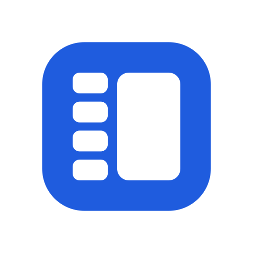
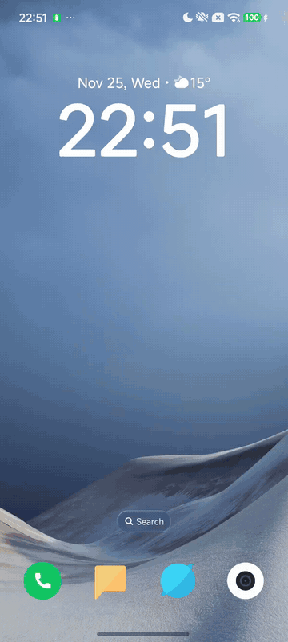
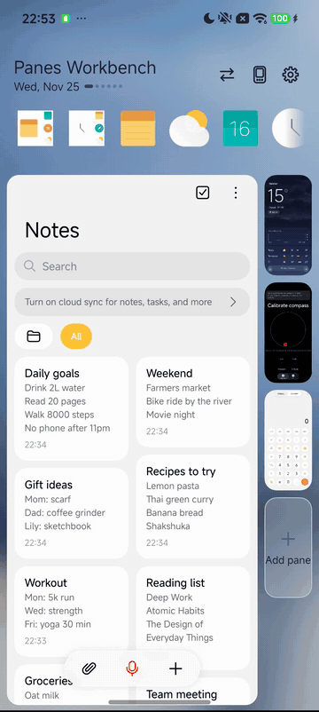
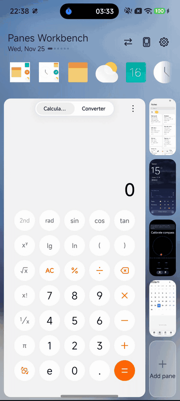
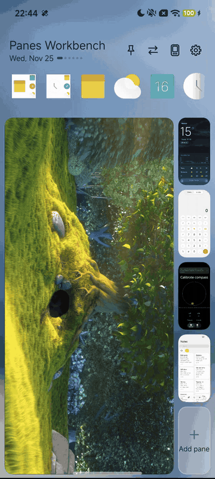
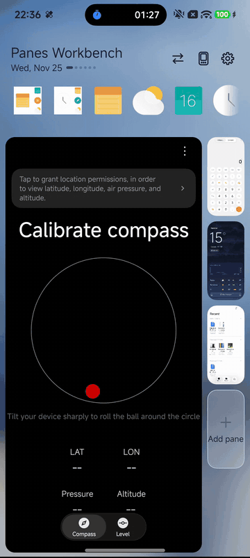
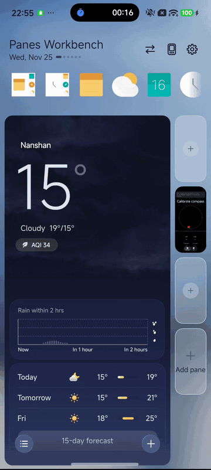

  

<h1 align="center">Panes（格子窓）</h1>

ひとつの画面で、いくつものアプリを同時に。

  
  
  
  
  
  
  
  

<a href="README.md">English</a> · <a href="README.md#格窗工作台">简体中文</a> · <a href="README.zh-TW.md">繁體中文</a> · <a href="README.ja.md">日本語</a> · <a href="README.ko.md">한국어</a>

Panes は LSPosed モジュールです。画面を作業台に変えます。**作業用の大窓がひとつ、その横に小窓の列。** 小窓の中身は実際に動いているアプリで、動画は再生を続け、フィードも流れ続けます。小窓をタップすると、その場で大窓と入れ替わります。スマホ、折りたたみ、タブレット、縦でも横でも使い方は同じです。

ランチャーを置き換えず、システムのテーマも変えません。作業台を閉じれば、スマホは元のままです。

  

## できること

### どの画面でも同じレイアウト

ストレート、縦折り、横折り、ワイドな折りたたみ、タブレット。どれも「上にコントロールバー、大窓、小窓の列」です。窓は画面に合わせて拡大縮小し、折りたたみやタブレットを回転させても作業台がついてきます。

### 小窓は最大 12 個、いつでも追加・削除

列の一番下の **小窓を追加** をタップするとひとつ増えます。小窓の中で内側へスワイプするとアプリを閉じ、空いた小窓でもう一度スワイプするとその枠を削除します。小窓をタップすると大窓と入れ替わります。

  

  

### 動画とゲームをピン留め

大窓で動画やゲームが動いていると、コントロールバーにピン留めボタンが出ます。タップすると映像がピン留めエリアへ移り、下の大窓と小窓はそのまま使えます。

- 縦持ちではピン留めエリアは画面上部、折りたたみやタブレットを横にすると左側です。
- 映像は元の比率のまま収まります。切り取りも引き伸ばしもしません。縦持ちで全画面の横向き動画をピン留めすると、上下に黒帯が残りません。
- ページ内のプレーヤー、横向き全画面、縦型ショート動画、横向き・縦向きのゲーム、どれもピン留めできます。動画だけを映したいときは、先にアプリ内で全画面にしてからピン留めします。
- 解除するには **ピン留め解除** をタップするか、ピン留め側の画面端から内側へスワイプします。映像は大窓に戻り、再生は続きます。

  

### シーン

大窓と小窓のアプリ一式をシーンとして保存できます。「仕事」にメール・カレンダー・チャット、「視聴」に動画アプリとメッセンジャー、というように。シーンをお気に入りバーに置けば、ワンタップで一式が開きます。小窓が足りなければ自動で増えます。

  

### 新しいアプリは大窓で開く

通知、リンク、クイック設定のどこから開いても、アプリは大窓に入ります。それまで大窓にあったアプリは閉じられず、空いている小窓へ移ります。

  

### そのほか

| 機能 | 使い方 |
|---|---|
| お気に入りバー | コントロールバーによく使うアプリとシーンを並べます。タップで大窓に、小窓へドラッグするとその小窓で開きます。クローンアプリにも対応 |
| いろいろな開き方 | 左下・右下の角から斜めスワイプ、2 本指の上下スワイプ、ステータスバーの横スワイプ、クイック設定の Panes タイル。ゲームではジェスチャーを無効にできます |
| ファイルを小窓へドラッグ | 大窓で画像やファイルを長押しして小窓に落とすと、そのアプリが開いているページ（たとえばチャット）に入ります |
| 没入モード | 大窓がぼかした壁紙の上で大きく中央に、小窓は下の Dock にまとまります |
| スマートタイトル | 時刻、ポモドーロタイマー、次の予定、温度、充電電力、通信速度をコントロールバーに。タップで切り替え |
| 省電力 | 小窓は 30 fps、大窓に入るとすぐフルフレームレート。使っていない小窓のアプリは「アプリを休止」で自動的に休止 |
| 自動化 | Tasker や MacroDroid から、サイドキー、フローティングボール、スケジュールで作業台を開閉 |

## 無料とアンロック

作業台を初めて開いてから 1 日間は、すべての機能を無料で使えます。

**ずっと無料：** 大窓と小窓 4 個まで、すべての開き方、お気に入りバー、ファイルのドラッグ、シーン 2 個、自動化。

**アンロックで追加：** 動画とゲームのピン留め、小窓 5〜12 個、シーンの追加、没入モード、複数のタイトルグループ、アプリの休止。

**US$2.49 の買い切りで、1 台のスマホでずっと使えます。サブスクリプションはありません。** Panes の **Panes のロック解除** を開き、**PayPal またはカードで購入** をタップすると、支払い後すぐにアンロックコードが表示されます。

## 対応システム

Android 15 以降。動作確認済み：

- Xiaomi HyperOS
- ColorOS / OxygenOS（OPPO、OnePlus、realme）
- vivo OriginOS
- HONOR MagicOS
- Samsung One UI
- Google Pixel およびその他の素に近い Android

移植 ROM や大きく改造された ROM でも動くことがありますが、そこでの不具合は修正しません。

## 必要なもの

- Root、Zygisk、LSPosed（新しい libxposed API に対応したビルド）。
- Panes はシステム UI、ランチャー、system_server の動作を変更します。導入前に復旧手段を用意してください。

## インストール

1. [Releases](https://github.com/Xposed-Modules-Repo/io.github.yishisanren.panes/releases/latest) から APK をダウンロードしてインストールします（パッケージ名 `io.github.yishisanren.panes`）。
2. LSPosed で **Panes** を有効にし、推奨スコープ（システム UI、システムフレームワーク、LSPosed が挙げていれば端末のランチャー）にチェックを入れます。
3. 再起動します。Panes を更新するたびに再起動してください。
4. **Panes** を開き、お気に入りのアプリと作業台の開き方を選びます。

## ダウンロードとフィードバック

- ダウンロード：このページの [Releases](https://github.com/Xposed-Modules-Repo/io.github.yishisanren.panes/releases/latest) にある APK。
- 不具合や要望：[github.com/yishisanren/panes-feedback](https://github.com/yishisanren/panes-feedback)、または Panes 内の **ヘルプとフィードバック**（機種とバージョンが自動で入力されます）。

## 謝辞

lujinxin 氏に感謝します。Panes は氏のオープンソース NeXtep をもとに作られました。NeXtep は Smartisan の OneStep へのオマージュです。NeXtep がなければ Panes もありませんでした。
