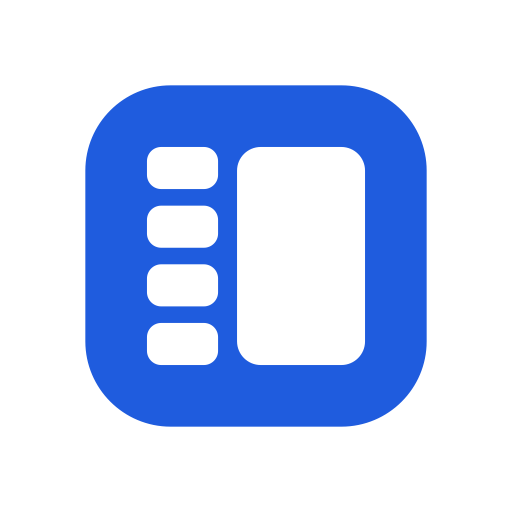
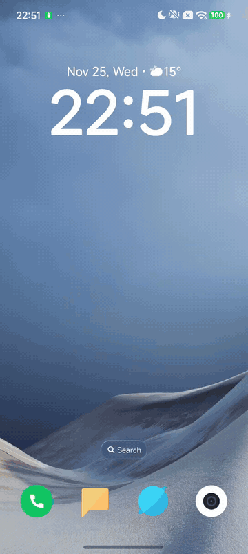
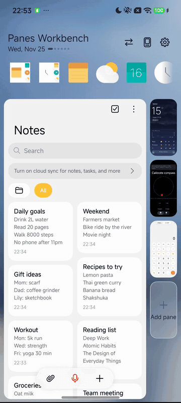
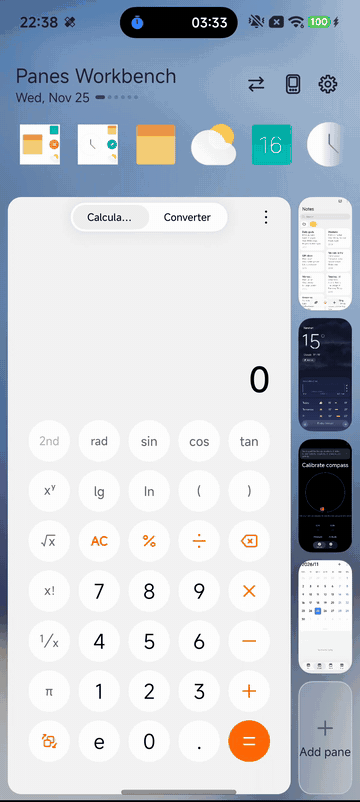
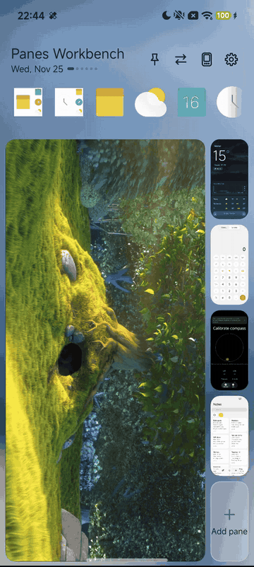
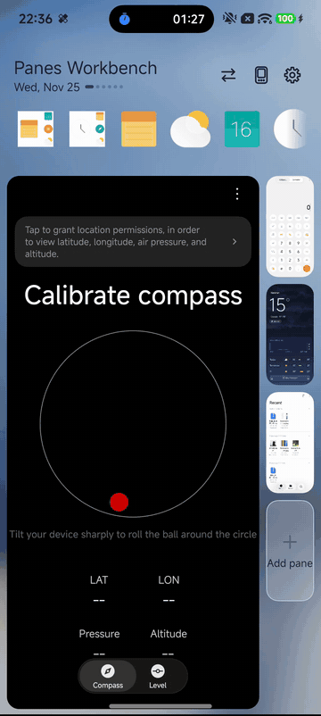
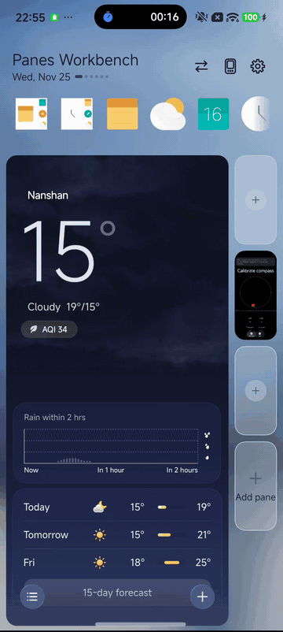

  

<h1 align="center">Panes（격자창）</h1>

한 화면에서 여러 앱을 동시에.

  
  
  
  
  
  
  
  

<a href="README.md">English</a> · <a href="README.md#格窗工作台">简体中文</a> · <a href="README.zh-TW.md">繁體中文</a> · <a href="README.ja.md">日本語</a> · <a href="README.ko.md">한국어</a>

Panes는 LSPosed 모듈입니다. 화면을 작업대로 바꿉니다. **작업하는 큰 창 하나, 그 옆에 작은 창 한 줄.** 작은 창 안의 앱은 실제로 실행 중이어서 영상은 계속 재생되고 피드도 계속 움직입니다. 작은 창을 탭하면 그 자리에서 큰 창과 바뀝니다. 휴대폰, 폴더블, 태블릿, 세로든 가로든 사용법은 같습니다.

런처를 바꾸지 않고 시스템 테마도 건드리지 않습니다. 작업대를 닫으면 휴대폰은 원래 그대로입니다.

  

## 할 수 있는 일

### 모든 화면에 같은 레이아웃

바형, 플립, 폴드, 와이드 폴더블, 태블릿 모두 「위쪽 컨트롤 바, 큰 창, 작은 창 열」입니다. 창은 화면에 맞춰 비율대로 조절되고, 폴더블이나 태블릿을 돌리면 작업대도 따라갑니다.

### 작은 창 최대 12개, 필요할 때 추가·삭제

열 맨 아래의 **작은 창 추가**를 탭하면 하나 늘어납니다. 작은 창 안에서 안쪽으로 밀면 앱이 닫히고, 빈 작은 창에서 한 번 더 밀면 그 칸이 삭제됩니다. 작은 창을 탭하면 큰 창과 자리를 바꿉니다.

  

  

### 영상과 게임 고정

큰 창에서 영상이 재생 중이거나 게임이 실행 중이면 컨트롤 바에 고정 버튼이 나타납니다. 탭하면 화면이 고정 영역으로 옮겨지고, 아래의 큰 창과 작은 창은 그대로 쓸 수 있습니다.

- 세로로 들면 고정 영역은 화면 위쪽, 폴더블이나 태블릿을 가로로 들면 왼쪽입니다.
- 화면은 원래 비율 그대로 들어갑니다. 자르거나 늘리지 않습니다. 세로로 든 상태에서 전체 화면 가로 영상을 고정하면 위아래에 검은 띠가 남지 않습니다.
- 페이지 안의 플레이어, 가로 전체 화면, 세로 쇼츠 영상, 가로·세로 게임 모두 고정할 수 있습니다. 영상만 보려면 앱에서 먼저 전체 화면으로 만든 뒤 고정을 탭하세요.
- 해제하려면 **고정 해제**를 탭하거나, 고정된 쪽 화면 가장자리에서 안쪽으로 밉니다. 화면은 큰 창으로 돌아가 계속 재생됩니다.

  

### 장면

큰 창과 작은 창에 있는 앱 한 세트를 장면으로 저장합니다. 「업무」에는 메일·캘린더·메신저, 「시청」에는 영상 앱과 메신저처럼요. 장면을 즐겨찾기 바에 두면 한 번 탭으로 세트 전체가 열립니다. 작은 창이 모자라면 자동으로 늘어납니다.

  

### 새 앱은 큰 창에서 열림

알림, 링크, 빠른 설정 어디서 열든 앱은 큰 창으로 들어갑니다. 원래 있던 앱은 닫히지 않고 빈 작은 창으로 옮겨집니다.

  

### 그 밖에

| 기능 | 사용법 |
|---|---|
| 즐겨찾기 바 | 컨트롤 바에 자주 쓰는 앱과 장면을 둡니다. 탭하면 큰 창에서, 작은 창으로 끌어다 놓으면 그 창에서 열립니다. 복제 앱 지원 |
| 여러 가지 여는 방법 | 왼쪽 아래·오른쪽 아래 모서리에서 대각선 스와이프, 두 손가락 위아래 스와이프, 상태 표시줄 가로 스와이프, 빠른 설정의 Panes 타일. 게임에서는 제스처가 동작하지 않게 할 수 있습니다 |
| 파일을 작은 창으로 끌기 | 큰 창에서 이미지나 파일을 길게 눌러 작은 창에 놓으면 그 앱이 열어 둔 페이지(예: 대화방)에 들어갑니다 |
| 몰입 모드 | 큰 창이 흐린 배경화면 위에서 크게 가운데로, 작은 창은 아래 Dock으로 모입니다 |
| 스마트 제목 | 시간, 뽀모도로 타이머, 다음 일정, 온도, 충전 전력, 네트워크 속도를 컨트롤 바에. 탭하면 전환 |
| 배터리 절약 | 작은 창은 30 fps, 큰 창으로 오면 바로 최대 프레임. 쓰지 않는 작은 창의 앱은 「앱 절전」으로 자동 절전 |
| 자동화 | Tasker와 MacroDroid로 측면 키, 플로팅 볼, 예약에서 작업대를 여닫기 |

## 무료와 잠금 해제

작업대를 처음 연 뒤 1일 동안은 모든 기능이 무료입니다.

**계속 무료:** 큰 창과 작은 창 4개까지, 모든 여는 방법, 즐겨찾기 바, 파일 끌어다 놓기, 장면 2개, 자동화.

**잠금 해제하면 추가:** 영상과 게임 고정, 작은 창 5~12개, 장면 추가, 몰입 모드, 여러 제목 그룹, 앱 절전.

**US$2.49, 한 번 결제로 휴대폰 한 대에서 계속 사용합니다. 구독이 아닙니다.** Panes에서 **Panes 잠금 해제**를 열고 **PayPal 또는 카드로 구매**를 탭하면, 결제 직후 잠금 해제 코드가 표시됩니다.

## 지원 시스템

Android 15 이상. 동작 확인:

- Xiaomi HyperOS
- ColorOS / OxygenOS (OPPO, OnePlus, realme)
- vivo OriginOS
- HONOR MagicOS
- Samsung One UI
- Google Pixel 및 순정에 가까운 Android

포팅 ROM이나 크게 개조된 ROM에서도 동작할 수 있지만, 그런 ROM의 문제는 수정하지 않습니다.

## 필요한 것

- 루트, Zygisk, LSPosed(새 libxposed API를 지원하는 빌드).
- Panes는 시스템 UI, 런처, system_server의 동작을 바꿉니다. 설치 전에 복구 수단을 준비하세요.

## 설치

1. [Releases](https://github.com/Xposed-Modules-Repo/io.github.yishisanren.panes/releases/latest)에서 APK를 내려받아 설치합니다(패키지 이름 `io.github.yishisanren.panes`).
2. LSPosed에서 **Panes**를 켜고 권장 범위(시스템 UI, 시스템 프레임워크, LSPosed가 표시하면 기기의 런처)를 체크합니다.
3. 재부팅합니다. Panes를 업데이트할 때마다 재부팅하세요.
4. **Panes**를 열고 즐겨 쓰는 앱과 작업대 여는 방법을 고릅니다.

## 다운로드와 피드백

- 다운로드: 이 페이지 [Releases](https://github.com/Xposed-Modules-Repo/io.github.yishisanren.panes/releases/latest)의 APK.
- 버그와 제안: [github.com/yishisanren/panes-feedback](https://github.com/yishisanren/panes-feedback), 또는 Panes 안의 **도움말 및 피드백**(기종과 버전이 자동으로 입력됩니다).

## 감사

lujinxin 님께 감사드립니다. Panes는 그의 오픈소스 NeXtep을 바탕으로 만들었습니다. NeXtep은 Smartisan OneStep에 대한 오마주입니다. NeXtep이 없었다면 Panes도 없었습니다.
