

  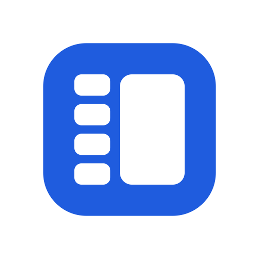

<h1 align="center">Panes</h1>

Keep your apps in view.

  
  
  
  
  
  
  
  

<a href="README.md">English</a> · <a href="README.md#格窗工作台">简体中文</a> · <a href="README.zh-TW.md">繁體中文</a> · <a href="README.ja.md">日本語</a> · <a href="README.ko.md">한국어</a>

Panes is an LSPosed module that turns your screen into a workbench: **one main pane to work in, and a column of live side panes next to it**. Side panes are real, running apps: videos keep playing, feeds keep moving. Tap one and it swaps with the main pane in place. Phone, foldable or tablet, portrait or landscape, it works the same way.

Panes doesn't replace your launcher or restyle your system. Close the workbench and your phone is exactly as it was.

  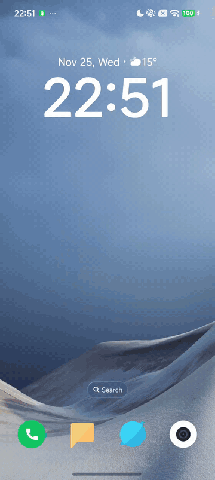

## What it does

### One layout for every screen

Bar phones, flip phones, book-style foldables, wide foldables and tablets all get the same layout: control bar on top, main pane, side-pane column. Panes scale with the screen. Rotate a foldable or tablet and the workbench follows.

### Up to 12 side panes, add and remove as you go

Tap **Add pane** at the bottom of the column to get one more. Swipe inward inside a side pane to close its app; swipe the empty pane again to remove it. Tap a side pane and it trades places with the main pane.

  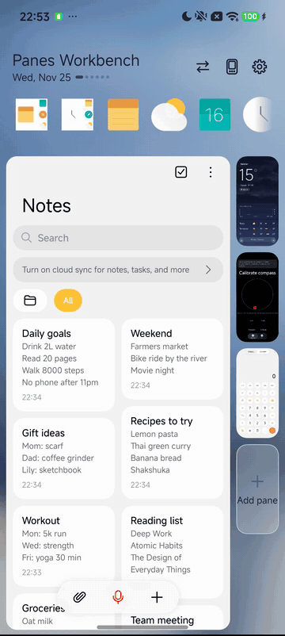

  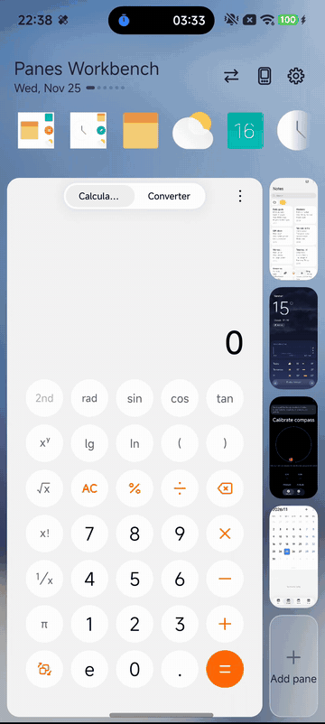

### Pin videos and games

When the main pane is playing a video or running a game, a Pin button appears in the control bar. Tap it and the picture moves to the pinned area, while the main pane and side panes below keep working.

- Holding the phone upright, the pinned area sits on top. Holding a foldable or tablet sideways, it sits on the left.
- The picture keeps its aspect ratio: no cropping, no stretching. A full-screen landscape video pinned in portrait fills the width with no black bars.
- In-page players, full-screen landscape video, vertical short videos, landscape and portrait games can all be pinned. To pin just the video, go full screen in the app first, then tap Pin.
- To unpin, tap **Unpin**, or swipe in from the screen edge on the pinned side. The picture goes back to the main pane and keeps playing.

  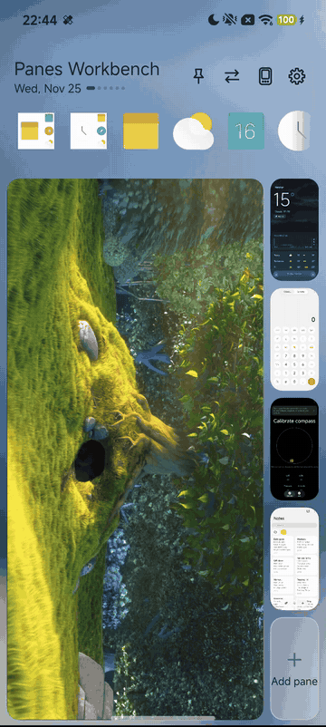

### Scenes

Save the apps in your main and side panes as a scene: "Work" with mail, calendar and chat, "Watch" with a video app and a messenger. Put the scene in the favourites bar and open the whole set with one tap. Panes adds side panes if the scene needs more.

  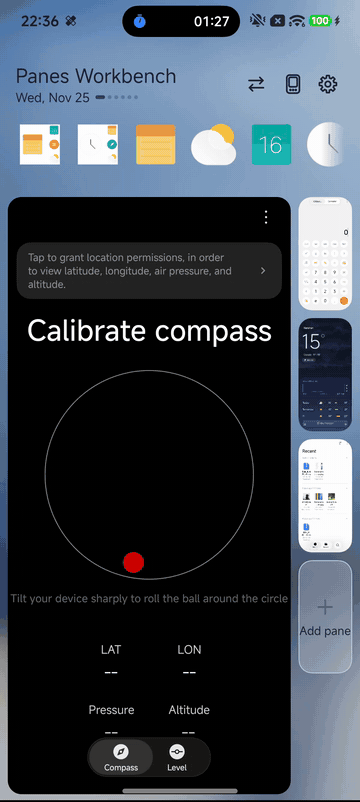

### New apps open in the main pane

From a notification, a link or Quick Settings, an app always opens in the main pane. The app that was there moves to a free side pane instead of being closed.

  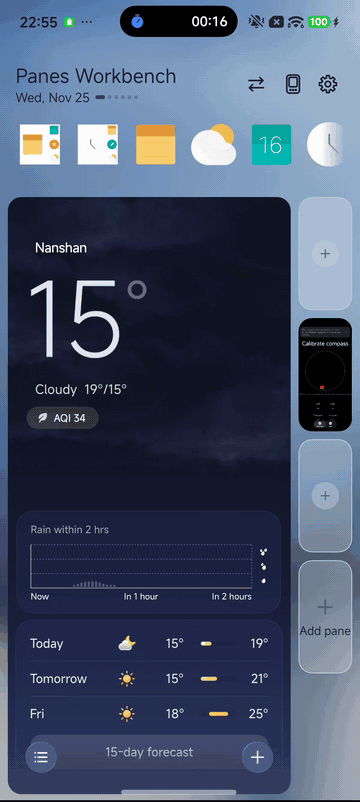

### More

| Feature | How it works |
|---|---|
| Favourites bar | Your favourite apps and scenes in the control bar. Tap to open in the main pane, drag onto a side pane to open it there. Cloned (dual) apps supported |
| Many ways to open | Swipe diagonally from the bottom-left or bottom-right corner, two-finger swipe up or down, swipe across the status bar, or the Panes Quick Settings tile. Exclude games so gestures never fire by accident |
| Drag files into side panes | Long-press an image or file in the main pane and drop it on a side pane; it lands in that app's current page, such as an open chat |
| Immersive mode | The main pane grows and centres over a blurred wallpaper; side panes shrink into a bottom Dock |
| Smart title | Time, a Pomodoro timer, your next event, temperature, charging power or network speed in the control bar; tap to cycle |
| Battery friendly | Side panes refresh at 30 fps and jump to full frame rate in the main pane. Sleep apps: chosen apps in side panes sleep after a short idle and wake with one tap |
| Automation | Tasker and MacroDroid commands to toggle the workbench from a side key, floating ball or schedule |

## Free and unlocked

After you first open the workbench, every feature is free for 1 day.

**Always free:** a main pane and up to 4 side panes, every way to open, the favourites bar, drag and drop, 2 scenes, automation.

**Unlock adds:** video and game pinning, 5 to 12 side panes, more scenes, immersive mode, several title groups, Sleep apps.

**US$2.49, pay once, unlocked for good on one phone. No subscription.** In Panes, open **Unlock Panes** and tap **Pay with PayPal or a card**; the unlock code shows right after payment.

## Supported systems

Android 15 and newer. Tested on:

- Xiaomi HyperOS
- ColorOS and OxygenOS (OPPO, OnePlus, realme)
- vivo OriginOS
- HONOR MagicOS
- Samsung One UI
- Google Pixel and other near-stock Android

Ported and heavily modified ROMs may work, but problems on them are not fixed.

## Requirements

- Root with Zygisk and LSPosed (a build with the modern libxposed API).
- Panes changes how System UI, the launcher and system_server behave. Have a way to recover before you install.

## Install

1. Download the APK from [Releases](https://github.com/Xposed-Modules-Repo/io.github.yishisanren.panes/releases/latest) and install it (package `io.github.yishisanren.panes`).
2. In LSPosed, enable **Panes** and tick the recommended scope: System UI, System Framework, and your phone's launcher if LSPosed lists it.
3. Reboot. Reboot again after every Panes update.
4. Open **Panes**, pick your favourite apps and a way to open the workbench.

## Download and feedback

- Download: the APK under [Releases](https://github.com/Xposed-Modules-Repo/io.github.yishisanren.panes/releases/latest) on this page.
- Bugs and ideas: [github.com/yishisanren/panes-feedback](https://github.com/yishisanren/panes-feedback), or **Help & feedback** inside Panes, which fills in your phone and version for you.

## Credits

Thanks to lujinxin: Panes is built on his open-source NeXtep, itself a tribute to Smartisan's OneStep. Without NeXtep there would be no Panes.

---

<h1 align="center">格窗工作台</h1>

一块屏幕，同时用好几个应用。

格窗是一个 LSPosed 模块，把屏幕变成一张工作台：**一个大窗做事，旁边一列小窗候着**。小窗里是真实运行的应用，画面一直在动，点一下就和大窗互换。直板手机、折叠屏、平板，竖着拿、横着拿，都是同一套用法。

不换桌面、不改系统主题。关掉工作台，手机就回到原来的样子。

  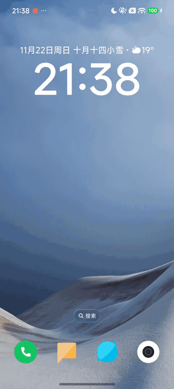

## 能做什么

### 一套排版，适配所有屏幕

直板手机、小折叠、大折叠、阔折叠、平板，统一成「顶部控制区 + 大窗 + 小窗列」，窗口按屏幕比例等比缩放，折叠屏、平板横着拿也是同一套用法。

### 小窗最多 12 个，随加随删

小窗列底部点「＋ 增加小窗」，多一格。在小窗里往屏幕中间滑，关掉应用、小窗留空；在空小窗上再滑一次，这一格就删掉。点小窗，它和大窗原地互换。

  

  

### 视频和游戏置顶：看到什么，置顶什么

大窗里在播视频或在玩游戏时，控制区出现置顶按钮。点一下，大窗里的画面原样挪到置顶区，下面的大窗、小窗照常用。

- 竖着拿，置顶区在屏幕顶部；横着拿（折叠屏展开、平板），置顶区在左侧。
- 画面按原比例完整放进置顶区，不裁切、不拉伸。竖着拿时，全屏的横屏视频置顶后上下不留黑边。
- 页面里的小播放器、横屏全屏、竖版全屏视频、横着玩和竖着玩的游戏，都能置顶。想只看视频画面，先在大窗里点全屏，再点置顶。
- 取消置顶：点「取消置顶」，画面原样回到大窗；或在置顶区那一侧的屏幕边缘往里划。

  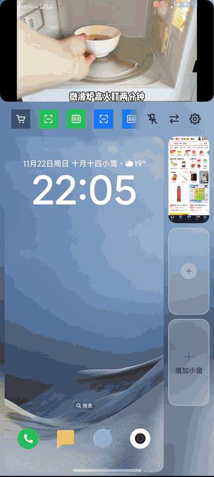

### 工作场景

把大窗和小窗里的一套应用存成场景，比如「工作」放钉钉、飞书、邮箱，「追剧」放视频和聊天。场景可以放进常用应用栏，点一下整套打开，需要几个小窗就自动补几个。

  

### 新应用自动进大窗

不管从通知、链接还是控制中心打开，应用都进大窗，原来的应用自动挪进空小窗，不会被关掉。

  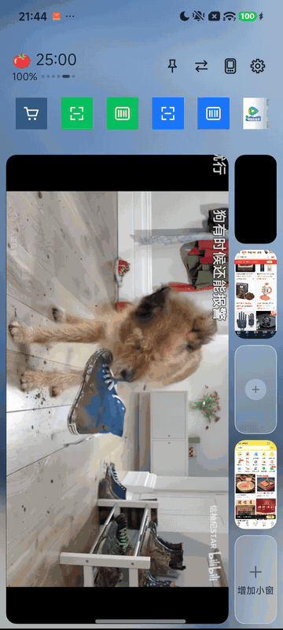

### 更多

| 功能 | 怎么用 |
|---|---|
| 常用应用栏 | 控制区一排常用应用和场景，点一下在大窗打开，拖到小窗就在小窗打开；分身应用可选 |
| 多种打开方式 | 左下角或右下角斜滑、双指上下滑、状态栏横滑，或控制中心「格窗」开关；游戏可设为手势不生效 |
| 拖文件进小窗 | 在大窗长按图片或文件，拖到小窗上，直接落进它当前的页面，比如正开着的微信聊天 |
| 付款与扫一扫 | 微信、支付宝的扫一扫和付款码，放在常用应用栏一点就开；只打开对应页面，不读取账户 |
| 比价 | 商品名输一次，几个外卖或购物应用同时搜，结果并排对照；只打开搜索结果，不抓价格、不下单 |
| 沉浸模式 | 大窗放大居中，四周模糊壁纸，小窗收成底部 Dock |
| 顶栏标题 | 时间、番茄钟、下一个日程、温度、充电功率、网速，点一下切到下一组 |
| 省电 | 小窗按 30 帧刷新，换到大窗立刻满帧；不常用的小窗可设「应用休眠」 |
| 自动化 | 支持 Tasker、MacroDroid，把工作台绑到侧键、悬浮球或定时任务 |

  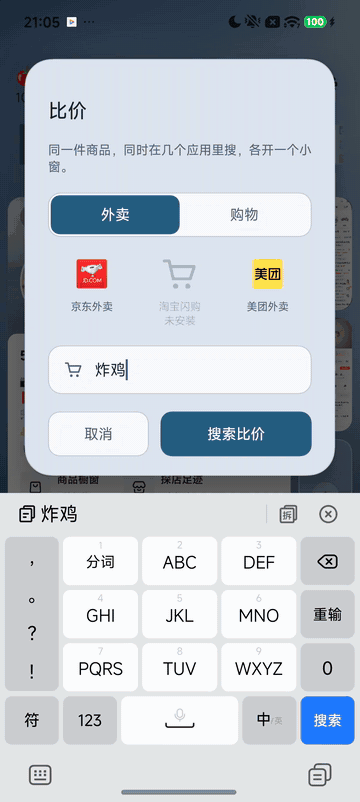

## 免费和解锁

第一次打开工作台后，所有功能免费用 1 天。

**一直免费**：大窗加最多 4 个小窗、打开方式、常用应用栏、拖文件、付款与扫一扫、2 个工作场景、自动化。

**解锁后多得到**：视频和游戏置顶、5～12 个小窗、更多工作场景、沉浸模式、多组顶栏标题、比价、应用休眠。

在格窗设置里点「解锁格窗」即可。

## 支持的系统

Android 15 及以上。实测支持：小米 HyperOS、ColorOS（OPPO、一加、真我）、vivo OriginOS、荣耀 MagicOS、三星 One UI、Google Pixel 及其他类原生系统。

系统移植版和魔改版随缘使用，有问题不修。

## 使用要求

- 已 Root，装好 Zygisk 和 LSPosed（支持 libxposed 新 API）。
- 本模块会修改系统界面、桌面和 system_server 的行为，刷之前请准备好救砖手段。

## 安装

1. 下载 APK 安装（包名 `io.github.yishisanren.panes`）。
2. 在 LSPosed 里启用「格窗工作台」，勾选推荐作用域（SystemUI、系统框架，以及你手机的桌面）。
3. 重启手机。
4. 打开「格窗」，选常用应用，选一种打开方式。

## 下载和反馈

- 下载：本页「版本」里的 APK，或 [夸克网盘](https://pan.quark.cn/s/bb615e3d0d68?pwd=X5gm#/list/share)
- 反馈：[问题与建议问卷](https://my.feishu.cn/share/base/shrcn7gYOpCevm4vjtweE4Vyywh)

## 致谢

感谢原作者 lujinxin：格窗是在他开源的 NeXtep 基础上改出来的，NeXtep 致敬锤子的 OneStep，没有 NeXtep 就没有格窗。
