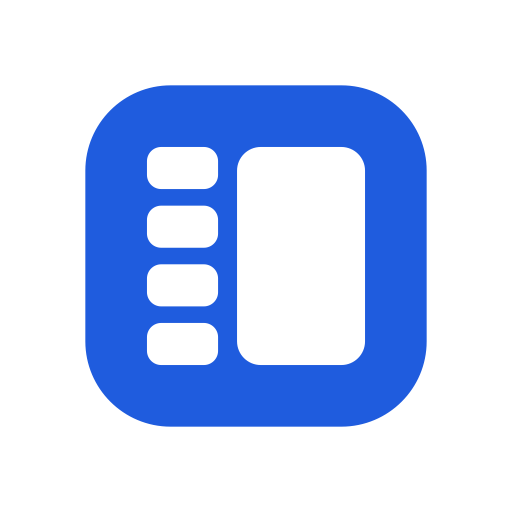
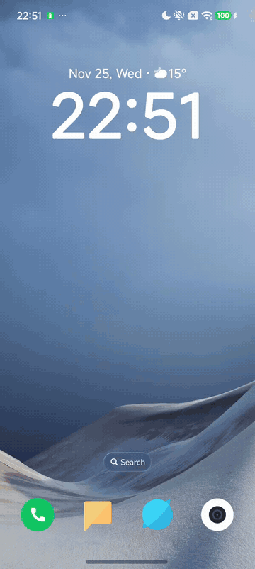
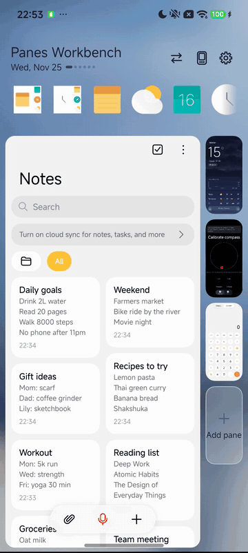
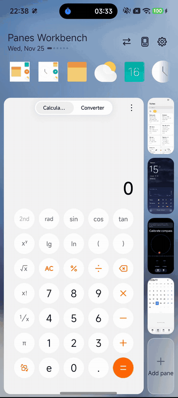
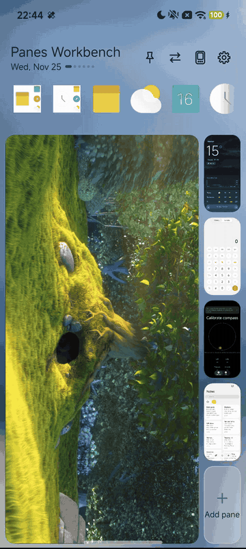
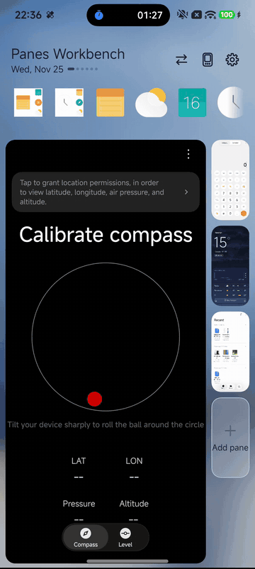
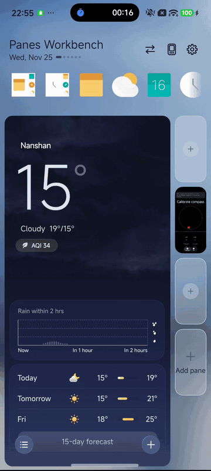

  

<h1 align="center">格窗工作台</h1>

一塊螢幕，同時用好幾個應用。

  
  
  
  
  
  
  
  

<a href="README.md">English</a> · <a href="README.md#格窗工作台">简体中文</a> · <a href="README.zh-TW.md">繁體中文</a> · <a href="README.ja.md">日本語</a> · <a href="README.ko.md">한국어</a>

格窗是一個 LSPosed 模組，把螢幕變成一張工作台：**一個大窗做事，旁邊一列小窗候著**。小窗裡是真實執行中的應用，畫面一直在動，點一下就和大窗互換。直立式手機、摺疊機、平板，直拿、橫拿，都是同一套用法。

不換桌面、不改系統主題。關掉工作台，手機就回到原來的樣子。

  

## 能做什麼

### 一套排版，適配所有螢幕

直立式手機、小摺疊、大摺疊、闊摺疊、平板，統一成「頂部控制區 + 大窗 + 小窗列」，視窗依螢幕比例等比縮放，摺疊機、平板橫拿也是同一套用法。

### 小窗最多 12 個，隨加隨刪

小窗列底部點「＋ 增加小窗」，多一格。在小窗裡往螢幕中間滑，關掉應用、小窗留空；在空小窗上再滑一次，這一格就刪掉。點小窗，它和大窗原地互換。

  

  

### 影片和遊戲置頂：看到什麼，置頂什麼

大窗裡在播影片或在玩遊戲時，控制區出現置頂按鈕。點一下，大窗裡的畫面原樣挪到置頂區，下面的大窗、小窗照常用。

- 直拿，置頂區在螢幕頂部；橫拿（摺疊機展開、平板），置頂區在左側。
- 畫面依原比例完整放進置頂區，不裁切、不拉伸。直拿時，全螢幕的橫向影片置頂後上下不留黑邊。
- 頁面裡的小播放器、橫向全螢幕、直式全螢幕影片、橫著玩和直著玩的遊戲，都能置頂。想只看影片畫面，先在大窗裡點全螢幕，再點置頂。
- 取消置頂：點「取消置頂」，畫面原樣回到大窗；或在置頂區那一側的螢幕邊緣往裡滑。

  

### 工作場景

把大窗和小窗裡的一套應用存成場景，例如「工作」放郵件、行事曆、通訊軟體，「追劇」放影片和聊天。場景可以放進常用應用列，點一下整套開啟，需要幾個小窗就自動補幾個。

  

### 新應用自動進大窗

不管從通知、連結還是控制中心開啟，應用都進大窗，原來的應用自動挪進空小窗，不會被關掉。

  

### 更多

| 功能 | 怎麼用 |
|---|---|
| 常用應用列 | 控制區一排常用應用和場景，點一下在大窗開啟，拖到小窗就在小窗開啟；分身應用可選 |
| 多種開啟方式 | 左下角或右下角斜滑、雙指上下滑、狀態列橫滑，或控制中心「格窗」開關；遊戲可設為手勢不生效 |
| 拖檔案進小窗 | 在大窗長按圖片或檔案，拖到小窗上，直接落進它目前的頁面，例如正開著的聊天 |
| 沉浸模式 | 大窗放大置中，四周模糊桌布，小窗收成底部 Dock |
| 頂欄標題 | 時間、番茄鐘、下一個行程、溫度、充電功率、網速，點一下切到下一組 |
| 省電 | 小窗以 30 幀更新，換到大窗立刻滿幀；不常用的小窗可設「應用休眠」 |
| 自動化 | 支援 Tasker、MacroDroid，把工作台綁到側鍵、懸浮球或排程 |

## 免費和解鎖

第一次開啟工作台後，所有功能免費用 1 天。

**一直免費**：大窗加最多 4 個小窗、開啟方式、常用應用列、拖檔案、2 個工作場景、自動化。

**解鎖後多得到**：影片和遊戲置頂、5～12 個小窗、更多工作場景、沉浸模式、多組頂欄標題、應用休眠。

**US$2.49，一次付費，在一支手機上永久解鎖，不是訂閱。** 在格窗設定裡開啟「解鎖格窗」，點「PayPal 或銀行卡購買」，付款後頁面直接顯示解鎖碼。

## 支援的系統

Android 15 及以上。實測支援：

- 小米 HyperOS
- ColorOS / OxygenOS（OPPO、OnePlus、realme）
- vivo OriginOS
- HONOR MagicOS
- Samsung One UI
- Google Pixel 及其他類原生系統

系統移植版和魔改版隨緣使用，有問題不修。

## 使用要求

- 已 Root，裝好 Zygisk 和 LSPosed（支援 libxposed 新 API）。
- 本模組會修改系統介面、桌面和 system_server 的行為，刷之前請準備好救磚手段。

## 安裝

1. 從 [Releases](https://github.com/Xposed-Modules-Repo/io.github.yishisanren.panes/releases/latest) 下載 APK 安裝（套件名稱 `io.github.yishisanren.panes`）。
2. 在 LSPosed 裡啟用「格窗工作台」，勾選建議作用域（SystemUI、系統框架，以及 LSPosed 列出的手機桌面）。
3. 重新開機。每次更新格窗後都要重新開機。
4. 開啟「格窗」，選常用應用，選一種開啟方式。

## 下載和回饋

- 下載：本頁 [Releases](https://github.com/Xposed-Modules-Repo/io.github.yishisanren.panes/releases/latest) 裡的 APK。
- 問題與建議：[github.com/yishisanren/panes-feedback](https://github.com/yishisanren/panes-feedback)，或格窗裡的「說明與意見」（機型和版本會自動填好）。

## 致謝

感謝原作者 lujinxin：格窗是在他開源的 NeXtep 基礎上改出來的，NeXtep 致敬錘子的 OneStep，沒有 NeXtep 就沒有格窗。
